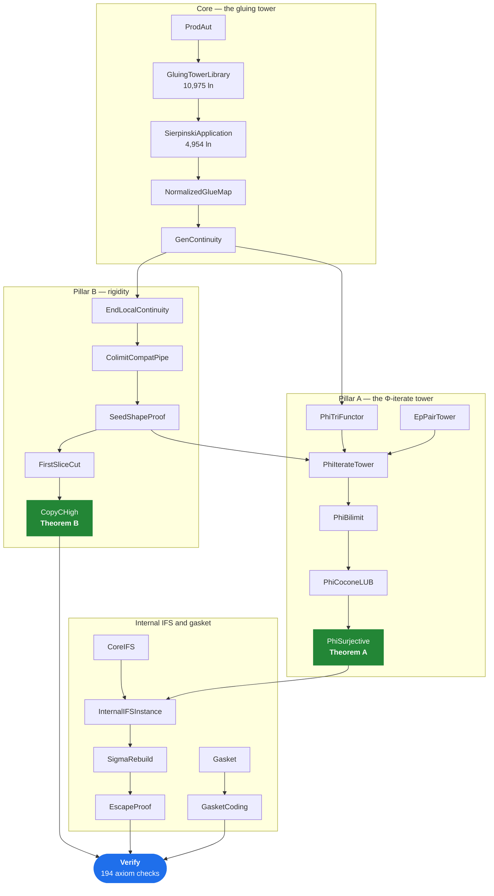

# D∞ — a machine-checked Lean 4 development

This directory is a **self-contained release**: 116 Lean modules whose import
closure is exactly what the headline theorems depend on. Nothing here is
optional, and nothing outside it is needed.

Everything is checked by Lean's kernel. There are no `sorry`s, no
`native_decide`, and no project-specific axioms — every result rests only on
Lean's three standard axioms.

| | |
|---|---|
| Modules | 116 |
| Lines of Lean | 44,118 |
| Toolchain | `leanprover/lean4:v4.32.2` |
| Mathlib | `v4.32.2` (rev `905b95818eb3`) |
| Entry point | `Dinfty.Verify` |
| Axiom checks | 194 |
| Status | builds clean; verified 2026-09-02 |

---

## What is proved

Two independent results, plus a machine-checked internal IFS and two negative
results. All of them are re-stated and re-checked in
[`Dinfty/Verify.lean`](Dinfty/Verify.lean), which is the single file a reviewer
needs to read.

### Theorem A — the bilimit is a fixed point of Φ

```lean
noncomputable example : PhiBilimit.phiB ≃o PhiIterateTower.phiTowerEP.Bilim :=
  PhiSurjective.theoremA_orderIso
```

`Φ(D∞^Φ) ≃o D∞^Φ`: the bilimit of the Φ-iterate tower is a fixed point of `Φ`
up to order-isomorphism.

### Theorem B — rigidity

```lean
example : Subsingleton (DInfty ≃o DInfty) := CopyCHigh.colimit_compat
example : Subsingleton (DBilimit ≃o DBilimit) := CopyCHigh.DBilimit_rigid
```

`D∞` has no non-identity order-automorphism, in both the colimit and the
bilimit presentation.

### The internal IFS, and two refutations

The development also builds an honest internal IFS on the carrier with all
three copy-maps **injective**, and machine-checks two *negative* results — that
`Fix σ_A = {⊥}` fails for the first IFS, and that no coding map onto the
Sierpiński gasket can be an open map, so that field of the interface must be
weakened to `IsQuotientMap`. Negative results are stated as theorems, not as
absent lemmas.

---

## 1. Installing the dependencies

You need **`elan`** (the Lean toolchain manager). Everything else — the exact
Lean version and all Mathlib sources — is pinned by the files in this
directory and fetched by `lake`.

<details open>
<summary><b>Linux / macOS / WSL</b></summary>

```bash
curl https://elan.lean-lang.org/elan-init.sh -sSf | sh -s -- -y
source "$HOME/.elan/env"
```
</details>

<details>
<summary><b>Windows (PowerShell)</b></summary>

```powershell
curl.exe -sSfL https://elan.lean-lang.org/elan-init.ps1 -o elan-init.ps1
powershell -ExecutionPolicy Bypass -f elan-init.ps1
```
</details>

`elan` reads [`lean-toolchain`](lean-toolchain) and installs Lean `v4.32.2`
automatically the first time you run `lake` in this directory — you do not
install Lean by hand.

Confirm it picked up the right version:

```bash
lake --version
# Lake version 5.0.0-src+f3b06c7 (Lean version 4.32.2)
```

### Fetch Mathlib

```bash
lake exe cache get     # downloads prebuilt Mathlib .olean files
```

> [!IMPORTANT]
> Do not skip `lake exe cache get`. Without it, `lake build` compiles all of
> Mathlib from source, which takes **hours** instead of minutes. If the cache
> download fails, re-run it — it is resumable.

Requirements: roughly 10 GB of free disk for Mathlib's sources and oleans, and
a network connection for this step only. The build itself is offline.

---

## 2. Building

```bash
lake build Dinfty.Verify
```

This is the acceptance target. It elaborates both headline theorems and prints
the axioms each one depends on.

```bash
lake build
```

The default target. It builds every one of the 116 modules — a superset of
`Dinfty.Verify`, and it also passes. Use this if you want the whole corpus
checked rather than just the closure of the headline results.

**Expected cost.** On a warm Mathlib cache the 116 modules take roughly
**15–20 minutes** of wall clock. The build parallelises, but one module is on
the critical path and cannot be split:

| Module | Elapsed |
|---|---:|
| `GluingTowerLibrary` | 583 s |
| `GlueAAGenReflectM` | 113 s |
| `ProjectionTripointed` | 51 s |
| all 113 others | < 20 s each |

Budget separately for `lake exe cache get`, which is network-bound and depends
on your connection. The build is incremental: if it is interrupted, re-running
resumes where it stopped rather than starting over.

You will see a large number of **style-linter warnings** (`open Classical`,
`show` vs `change`, line length). These are Mathlib house-style advisories, not
errors, and they do not affect correctness. **Warnings are expected; `error:`
lines are not.**

---

## 3. Verification

### Acceptance criteria

A clean run satisfies all five:

| # | Check | Expected |
|---|---|---|
| 1 | Build outcome | `Build completed successfully` — 3119 jobs for `Dinfty.Verify`, 3121 for `lake build` |
| 2 | `error:` lines | **0** |
| 3 | `declaration uses 'sorry'` | **0** |
| 4 | `sorryAx` / `Lean.ofReduceBool` | **0** |
| 5 | `#print axioms` results | **194**, all standard |

### The exact expected output

The 194 `#print axioms` commands do **not** all produce the same form. Three of
them report no axioms at all, so only 191 lines contain the phrase
`depends on axioms`. A clean run gives exactly this distribution:

| Result | Count | Meaning |
|---|---:|---|
| `depends on axioms: [propext, Classical.choice, Quot.sound]` | 176 | all three standard axioms |
| `depends on axioms: [propext, Quot.sound]` | 9 | choice-free |
| `depends on axioms: [propext]` | 6 | choice- and quotient-free |
| `does not depend on any axioms` | 3 | fully axiom-free |
| **total** | **194** | |

Every one of these is acceptable: `propext`, `Classical.choice` and
`Quot.sound` are Lean's three standard axioms, and the last three rows are
*stronger* results, not weaker ones — they depend on strictly fewer. The
acceptance rule is therefore **"the axiom set is a subset of the three
standard axioms"**, not "equals one of two specific lists".

The three declarations that need no axioms whatsoever are:

```
SigmaRebuild.base_pin_of_mem
SeamTriangle.address_seamless
EmbTagwise.canonGen_baseMapGen
```

Two markers would signal failure, and neither occurs anywhere in the build
output:

- **`sorryAx`** — a `sorry` reached the kernel. The proof has a hole.
- **`Lean.ofReduceBool`** — a `native_decide`, which trusts the compiler
  outside the kernel.

Both are absent from the log entirely, so even a bare
`grep -c sorryAx build.log` returns `0`.

### Run the checks

Capture the build output, then check it:

```bash
lake build Dinfty.Verify 2>&1 | tee build.log
```

Lake replays cached messages, so the 194 axiom results are re-emitted on every
run — you do not need a clean rebuild to re-check them.

Then summarise every axiom result:

```bash
grep -o "depends on axioms: \[[^]]*\]" build.log | sort | uniq -c
grep -c "does not depend on any axioms" build.log
```

Expected output — these four numbers and nothing else:

```
    176 depends on axioms: [propext, Classical.choice, Quot.sound]
      9 depends on axioms: [propext, Quot.sound]
      6 depends on axioms: [propext]
3
```

> [!TIP]
> When you read `#print axioms` output in a **terminal** rather than a
> redirected file, long axiom lists wrap across lines and a naive `grep` can
> truncate one — so a bad line may read as clean. Redirect to a file first, as
> above, or pipe through `tr '\n' ' '` before grepping.

<details>
<summary><b>One-shot acceptance script</b> (click to expand)</summary>

```bash
#!/usr/bin/env bash
# Run from this directory. Exits non-zero on any failure.
set -o pipefail
fail=0

lake build Dinfty.Verify 2>&1 | tee build.log

grep -q "Build completed successfully" build.log \
  || { echo "FAIL: build did not complete"; fail=1; }

for pat in "^error:" "declaration uses 'sorry'"; do
  n=$(grep -c "$pat" build.log)
  [ "$n" -eq 0 ] || { echo "FAIL: $n occurrences of '$pat'"; fail=1; }
done

# Every axiom result, one per line. Join wrapped lines first: harmless on a
# redirected log, essential if the output came from a terminal.
axioms=$(tr '\n' ' ' < build.log \
         | grep -o -e "depends on axioms: \[[^]]*\]" -e "does not depend on any axioms")

total=$(wc -l <<<"$axioms")
[ "$total" -eq 194 ] || { echo "FAIL: $total axiom results, expected 194"; fail=1; }

# Scoped to the axiom results. Neither marker appears anywhere in a clean log,
# but scoping keeps the check exact if prose ever mentions one.
bad=$(grep -e sorryAx -e "Lean.ofReduceBool" <<<"$axioms")
[ -z "$bad" ] || { echo "FAIL: sorry or native_decide reached the kernel:"; \
                   echo "$bad"; fail=1; }

# Accept any SUBSET of the three standard axioms, including the empty set.
nonstd=$(grep -v \
  -e "^depends on axioms: \[propext, Classical.choice, Quot.sound\]$" \
  -e "^depends on axioms: \[propext, Quot.sound\]$" \
  -e "^depends on axioms: \[propext\]$" \
  -e "^does not depend on any axioms$" <<<"$axioms" | sort -u)
[ -z "$nonstd" ] || { echo "FAIL: non-standard axioms:"; echo "$nonstd"; fail=1; }

[ "$fail" -eq 0 ] && echo "PASS: 194 axiom results, all standard, no sorry."
exit $fail
```
</details>

### What the 194 checks cover

`Verify.lean` is organised into 25 sections. Each re-states a result as an
anonymous `example` — so the statement in `Verify.lean` is type-checked against
the real theorem and cannot drift from it — and then prints its axioms.

| Section | What it pins down |
|---|---|
| `PillarA` | Theorem A: `Φ(D∞^Φ) ≃o D∞^Φ` |
| `PillarB` | Theorem B: rigidity of `DInfty` and `DBilimit` |
| `InternalIFS` | The internal IFS exists; all three σ-maps injective |
| `Escape` | **Refutation**: `Fix σ_A = {⊥}` is false for this IFS |
| `Rebuilt` | The repaired IFS, with the coincidence removed |
| `Projection` | `qAA` is explicit — a greatest element, never a `choice` |
| `EscapeHolds` | `Fix σ_A = {⊥}` for the rebuilt σ_A |
| `Gasket` | Γ is constructed, not assumed; the coding map is a quotient map |
| | **Refutation**: no coding map is open |
| `Link`, `Continuity`, `TwoObjects` | The bridge between the two pillars |
| 14 further `*Check` sections | Stage, embedding, seam, cover, chain and ideal invariants |

An `example` that failed to typecheck would be a build error, so criterion 2
already covers the statements; the axiom reports cover the proofs.

---

## 4. The import DAG

The dependency graph is **deep and narrow** rather than broad: 116 modules with
a longest import chain of 54 edges, ending at `Verify`. Every module is
reachable from the root [`Dinfty.lean`](Dinfty.lean), and exactly one module —
`Verify` — is imported by nothing.

The diagram below is the *transitive reduction* of the dependencies between the
headline modules, so every arrow is a real dependency and no arrow is implied
by another.



Two structural facts worth noting, both visible above:

- **The pillars are not independent all the way down.** `PhiIterateTower`
  imports `SeedShapeProof` — Pillar A's tower construction reuses Pillar B's
  seed machinery. Only the *statements* are independent.
- **The IFS sits on top of Theorem A**, not beside it: `InternalIFSInstance`
  imports `PhiSurjective`, because injectivity of the copy-maps is exactly what
  the earlier retract construction could not supply.

### Regenerating the full graph

The full 116-node graph is too dense to read here, but you can generate it —
the `importGraph` tool is already among the pinned dependencies:

```bash
lake exe graph --to Dinfty.Verify dag.dot     # or .pdf, .svg, .png
```

That emits all 116 nodes, transitively reduced to 148 edges. (`.pdf`, `.svg`
and `.png` additionally need Graphviz on your `PATH`; `.dot` never does.)

To recompute the shape directly from the sources, without building:

```bash
ls Dinfty/*.lean | wc -l                           # modules ........... 116
cat Dinfty/*.lean | wc -l                          # lines ........... 44118
grep -h '^import Dinfty\.' Dinfty/*.lean | wc -l   # import statements .. 189
```

---

## 5. Layout

```
.
├── README.md              this file
├── lean-toolchain         pins Lean v4.32.2 (read by elan)
├── lakefile.toml          pins Mathlib v4.32.2; defaultTargets = ["Dinfty"]
├── lake-manifest.json     pins the exact Mathlib revision (905b95818eb3)
├── Dinfty.lean            root module — imports all 116, the default target
└── Dinfty/                the 116 release modules
    ├── Verify.lean               start here: both theorems + 194 axiom checks
    ├── GluingTowerLibrary.lean   the general theory (10,975 ln)
    ├── SierpinskiApplication.lean  the concrete tower (4,954 ln)
    └── ...
```

### A note on scope

This directory is the release closure only. The wider research repository also
contains `AxChecks.lean` — a 752-line axiom audit of 325 further declarations,
on top of the 194 acceptance checks here — plus 34 archived research modules
recording refutations, measurements and abandoned routes. None of that is
required to check the theorems above, and none of it is imported here.

## Reproducibility

`lean-toolchain` and `lake-manifest.json` pin the compiler and every dependency
to an exact revision, so this build is reproducible: a peer running the two
commands in §2 gets the same 194 axiom reports.
